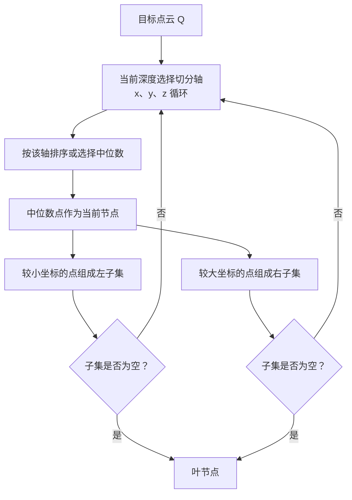
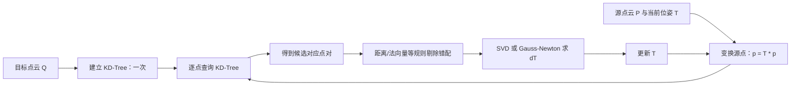

# ICP 匹配原理与 SVD 求解详解

> 本文以二维激光雷达和三维点云为背景，解释 ICP（Iterative Closest Point，迭代最近点）如何估计两帧点云之间的刚体位姿，并扩展介绍 SVD、最小二乘、李代数、Gauss–Newton、法向量、退化问题及其与 SLAM 的关系。

---

## 1. ICP 要解决什么问题

假设激光雷达在相邻两个时刻分别得到两帧点云：

- **源点云**（source）：`P = {p_i}`，通常是当前帧；
- **目标点云**（target）：`Q = {q_i}`，通常是上一帧或局部地图。

ICP 的目标是求一个刚体变换，使源点云变换后与目标点云尽可能重合：

$$
q_i \approx R p_i + t
$$

其中：

- $R$ 是旋转矩阵：二维为 $R \in SO(2)$，三维为 $R \in SO(3)$；
- $t$ 是平移向量；
- $SO(3)$ 表示所有满足 $R^T R = I$、$\det(R)=1$ 的三维纯旋转矩阵；
- $p_i$、$q_i$ 必须是对应点对，而 ICP 的关键工作就是反复寻找这些对应关系。

齐次坐标形式下，变换可写为：

$$
T =
\begin{bmatrix}
R & t \\
0 & 1
\end{bmatrix}
\in SE(3),
\quad
\tilde q = T\tilde p
$$

其中 $SE(3)$ 是三维刚体运动群；二维场景则使用 $SE(2)$。

---

## 2. ICP 的整体流程

ICP 名字中的三个词已经概括了算法：**迭代**、**最近**、**点**。

```text
输入：源点云 P、目标点云 Q、初始位姿 T0

T ← T0
重复直到收敛或达到最大迭代次数：
    1. 将源点云变换到目标坐标系：P' = T · P
    2. 为每个 P' 中的点在 Q 中寻找最近邻，建立对应关系
    3. 剔除距离过大或明显错误的对应点
    4. 基于保留下来的点对，求本次最优增量变换 ΔT
    5. 累积位姿：T ← ΔT · T
    6. 判断误差、位姿增量是否已足够小

输出：T
```

最常见的每轮操作如下。

| 步骤 | 含义 | 常用方法 |
| --- | --- | --- |
| 初始位姿 | 给 ICP 一个大致正确的起点 | 轮速计、IMU、里程计、上一帧结果、人工设定 |
| 对应点搜索 | 找到 `p_i` 在目标点云的匹配 `q_i` | KD-Tree 最近邻搜索 |
| 错配剔除 | 避免离群点、遮挡或动态物体误导优化 | 距离阈值、法向量夹角、互为最近邻、Trimmed ICP |
| 位姿估计 | 对当前对应点求最优刚体变换 | 点到点 SVD、点到平面 Gauss–Newton |
| 终止判断 | 防止无意义迭代 | 误差下降小、位姿增量小、到达最大轮数 |

### 2.1 为什么必须迭代

若两个点云初始位姿差很多，直接为每个点找“最近点”往往会得到错误对应。例如，一面墙平移很远后，墙上的点会匹配到另一端不相干的点。

因此 ICP 每次只根据**当前估计**做一小步修正。它本质是一个**局部优化算法**：初始值足够接近时效果好，初始值错误时容易收敛到错误的局部最优。

---

## 3. 点到点 ICP：最基础的目标函数

最经典的 ICP 使用点到点欧氏距离：

$$
\min_{R,t}\sum_{i=1}^{N}\left\|R p_i+t-q_i\right\|^2
$$

含义是：变换后的每个源点 $Rp_i+t$ 与对应目标点 $q_i$ 尽量接近。

这看起来是非线性问题，因为旋转矩阵 $R$ 受正交约束；但在对应点固定后，它存在非常高效的闭式解：**SVD 解法**，又常称为 Kabsch、Arun 或 Horn 类型的刚体配准解法。

> 注意：SVD 只解决“对应点已知时，如何计算最优刚体变换”。完整 ICP 仍需要在“找对应点”和“求变换”之间反复迭代。

---

## 4. 用 SVD 求最优刚体变换

以下约定使用**列向量**，并求从源点云到目标点云的变换：

$$
q_i \approx Rp_i+t
$$

不同教材或代码可能采用行向量、`source → target` 或 `target → source` 的不同约定，最后的矩阵转置顺序会不同。实现前必须统一坐标与乘法约定。

### 4.1 第一步：分别计算两个点集的质心

$$
\bar p=\frac{1}{N}\sum_{i=1}^{N}p_i,
\qquad
\bar q=\frac{1}{N}\sum_{i=1}^{N}q_i
$$

质心反映点云整体的位置。先把两个点集移到各自质心附近，可以把“旋转”和“平移”分开处理。

### 4.2 第二步：去中心化

$$
p_i'=p_i-\bar p,
\qquad
q_i'=q_i-\bar q
$$

去中心化后，点集的质心都在原点。此时只需要求使两个形状最匹配的旋转矩阵。

### 4.3 第三步：构造互协方差矩阵

> 在继续阅读 ICP 中的互协方差矩阵 $H$ 前，建议先理解第 4 章之后新增的“协方差矩阵”独立章节：普通协方差描述单个点集的分布形状；这里的互协方差描述两个已配对点集之间的方向关联。

$$
H=\sum_{i=1}^{N}p_i' {q_i'}^T
$$

或写成矩阵形式：

$$
H=P' {Q'}^T
$$

其中 $P'$、$Q'$ 的每一列是一对去中心化点。

`H` 描述了源点集与目标点集在各个方向上的关联程度：如果源点在某方向上的变化总与目标点某方向上的变化相关，那么对应元素会比较大。

### 4.4 第四步：对 H 做奇异值分解（SVD）

$$
H=U\Sigma V^T
$$

其中：

- $U$、$V$ 都是正交矩阵；
- $\Sigma$ 是非负对角矩阵，主对角线为奇异值 $\sigma_1,\sigma_2,\sigma_3$；
- 在二维情况下只有两个奇异值。

最优旋转为：

$$
R=V D U^T
$$

其中：

$$
D=
\begin{cases}
I, & \det(VU^T)>0 \\
\operatorname{diag}(1,1,-1), & \det(VU^T)<0
\end{cases}
$$

对于三维可统一写成：

$$
D=\operatorname{diag}(1,1,\det(VU^T))
$$

最后计算平移：

$$
t=\bar q-R\bar p
$$

得到的 $R,t$ 就是当前对应点对下的最小二乘最优刚体变换。

### 4.5 协方差矩阵：从点云分布到 PCA 与法向量

协方差矩阵（Covariance Matrix）用于描述一组多维数据围绕均值的**分散程度**，以及不同坐标维度如何**共同变化**。在点云处理中，它回答的问题是：

- 点云在哪些方向延展得最明显？
- 点云在某个局部区域更像直线、平面，还是立体团块？
- 局部表面的法向量朝向哪里？
- 这片几何结构是否足以约束 ICP 的某些位姿自由度？

它是 PCA、法向量估计、GICP，以及 ICP 退化分析的重要基础。

#### 4.5.1 从一维方差开始

对于 $N$ 个一维样本 $x_1,\ldots,x_N$，均值是：

$$
\bar{x}=\frac{1}{N}\sum_{i=1}^{N}x_i
$$

方差衡量数据偏离均值的平均平方程度：

$$
\operatorname{Var}(x)=\frac{1}{N}\sum_{i=1}^{N}(x_i-\bar{x})^2
$$

- 方差小：数据集中在均值附近；
- 方差大：数据沿该数轴分布得更分散；
- 采用平方使正、负偏差不会相互抵消，也会让远离均值的数据产生更大的影响。

例如，`[9, 10, 11]` 与 `[0, 10, 20]` 的均值都为 `10`，但后者的方差更大，说明它更分散。

#### 4.5.2 二维协方差：两个坐标是否一起变化

二维随机变量或二维点 $p_i=[x_i,y_i]^T$ 中，协方差定义为：

$$
\operatorname{Cov}(x,y)=\frac{1}{N}\sum_{i=1}^{N}(x_i-\bar{x})(y_i-\bar{y})
$$

其符号很有直观意义：

| 协方差 | 数据关系 | 点云形状直觉 |
| --- | --- | --- |
| $\operatorname{Cov}(x,y)>0$ | $x$ 增大时，$y$ 往往也增大 | 左下到右上的斜线趋势 |
| $\operatorname{Cov}(x,y)<0$ | $x$ 增大时，$y$ 往往减小 | 左上到右下的斜线趋势 |
| $\operatorname{Cov}(x,y)\approx0$ | 线性共同变化不明显 | 坐标轴平行的云团，或非线性关系 |

> 协方差接近 $0$ 只表示**线性**相关性弱，不等于两个变量一定完全无关。例如点呈圆环或抛物线分布时，协方差也可能接近 $0$。

下面的示意图中，`·` 表示数据点；椭圆长轴代表变化最大的方向。

```text
正协方差（x 增大，y 往往也增大）      负协方差（x 增大，y 往往减小）

y                                      y
^                · ·                   ^   ·
|             ·       ·                 |     ·
|          ·             ·               |       ·
|       ·                  ·             |         ·
+-------------------------> x            +-------------------------> x

协方差约为 0（轴对齐、近似圆形）
y
^          · · ·
|        ·       ·
|        ·       ·
|          · · ·
+-------------------------> x
```

#### 4.5.3 多维协方差矩阵的定义

对于 $d$ 维点集 $\{p_i\}_{i=1}^{N}$，先计算质心：

$$
\bar{p}=\frac{1}{N}\sum_{i=1}^{N}p_i
$$

令去中心化点为：

$$
\tilde{p}_i=p_i-\bar{p}
$$

则总体协方差矩阵为：

$$
C=\frac{1}{N}\sum_{i=1}^{N}\tilde{p}_i\tilde{p}_i^T
$$

工程实现中也常使用无偏样本协方差：

$$
C_{\text{sample}}=\frac{1}{N-1}\sum_{i=1}^{N}\tilde{p}_i\tilde{p}_i^T
$$

二者只差比例因子。对于 PCA 法向量方向、ICP/GICP 局部形状方向等任务，乘以正的常数不会改变特征向量，因此两种写法都常见；但做统计估计时，需明确自己采用的定义。

二维点云的协方差矩阵展开后为：

$$
C=
\begin{bmatrix}
\operatorname{Var}(x) & \operatorname{Cov}(x,y) \\
\operatorname{Cov}(x,y) & \operatorname{Var}(y)
\end{bmatrix}
$$

三维点云为：

$$
C=
\begin{bmatrix}
\operatorname{Var}(x) & \operatorname{Cov}(x,y) & \operatorname{Cov}(x,z) \\
\operatorname{Cov}(y,x) & \operatorname{Var}(y) & \operatorname{Cov}(y,z) \\
\operatorname{Cov}(z,x) & \operatorname{Cov}(z,y) & \operatorname{Var}(z)
\end{bmatrix}
$$

矩阵中：

- 对角线元素是各坐标轴上的方差；
- 非对角线元素是两个坐标分量之间的协方差；
- $C$ 是对称矩阵，因为 $\operatorname{Cov}(x,y)=\operatorname{Cov}(y,x)$；
- $C$ 是半正定矩阵：任何向量 $a$ 均满足 $a^TCa\ge0$；
- 因此 $C$ 的全部特征值都是实数且不小于 $0$。

矩阵形式更紧凑。若去中心化数据矩阵为：

$$
X=
\begin{bmatrix}
| & | & & | \\
\tilde{p}_1 & \tilde{p}_2 & \cdots & \tilde{p}_N \\
| & | & & |
\end{bmatrix}
\in\mathbb{R}^{d\times N}
$$

则：

$$
C=\frac{1}{N}XX^T
$$


#### 4.5.4 外积为什么会生成协方差矩阵

若一个二维去中心化点为：

$$
\tilde{p}=
\begin{bmatrix}
\tilde{x}\\
\tilde{y}
\end{bmatrix}
$$

则它与自身的外积为：

$$
\tilde{p}\tilde{p}^T=
\begin{bmatrix}
\tilde{x}^2 & \tilde{x}\tilde{y} \\
\tilde{x}\tilde{y} & \tilde{y}^2
\end{bmatrix}
$$

累加所有点并取平均后：

- 左上角就是 $x$ 的方差；
- 右下角就是 $y$ 的方差；
- 两个非对角线元素就是 $x,y$ 协方差。

这里的“外积”必须与内积区分：

| 运算 | 形式 | 输出 | 用途 |
| --- | --- | --- | --- |
| 内积（dot product） | $a^Tb$ | 标量 | 夹角、投影、相似度 |
| 外积（outer product） | $ab^T$ | 矩阵 | 协方差、线性变换、低秩近似 |
| 三维叉积（cross product） | $a\times b$ | 向量 | 法向量、旋转方向 |

#### 4.5.5 特征值、特征向量与 PCA

对协方差矩阵做特征值分解：

$$
Cv_j=\lambda_jv_j
$$

其中：

- $v_j$ 是单位特征向量，表示点云的一个主方向；
- $\lambda_j$ 是对应特征值，表示点云沿该方向的方差大小；
- 对称矩阵 $C$ 的特征向量彼此正交，可选择为一组正交坐标轴。

PCA（Principal Component Analysis，主成分分析）就是将坐标轴旋转到这些主方向上：

```text
原始 x/y 坐标系                    PCA 主坐标系

       y                                  v₂（小方差）
       ^                                  ^
       |      · ·                         |    · ·
       |   ·       ·                       |  ·     ·
       | ·            ·                    | ·         ·
       +---------------> x                 +------------------> v₁（大方差）
              斜着分布                          长轴被对齐到 v₁
```

在二维中，若按 $\lambda_1\ge\lambda_2$ 排序：

- $v_1$：数据变化最大的方向，即椭圆长轴；
- $v_2$：垂直于 $v_1$ 的次要方向，即椭圆短轴；
- $\lambda_1$、$\lambda_2$：分别表示沿两轴的扩散程度。

在三维中按：

$$
\lambda_1\ge\lambda_2\ge\lambda_3\ge0
$$

排序后，局部点云形状可由特征值直观判断：

| 特征值关系 | 局部几何形状 | 解释 |
| --- | --- | --- |
| $\lambda_1\gg\lambda_2\approx\lambda_3$ | 线状 | 主要只沿一个方向延展，例如杆、边缘 |
| $\lambda_1\approx\lambda_2\gg\lambda_3$ | 平面状 | 两个面内方向变化大，垂直平面方向变化极小 |
| $\lambda_1\approx\lambda_2\approx\lambda_3$ | 团块状 | 三个方向都分散，像角点附近、体点或较强噪声 |
| $\lambda_1,\lambda_2,\lambda_3$ 都很小 | 点状/邻域过小 | 局部点几乎重合，难以可靠判断形状 |

#### 4.5.6 用最小特征向量估计平面法向量

点云局部邻域近似为一个平面时，点在平面内的变化很大，而垂直平面的厚度通常只有传感器噪声。因此最小特征值 $\lambda_3$ 对应的特征向量 $v_3$ 就是局部平面的法向量：

$$
n=v_3,
\qquad
Cv_3=\lambda_3v_3
$$

```text
局部平面点云（侧视）

                   n = v₃（最小方差方向）
                   ↑
                   │  点到平面的厚度很小：λ₃
   · · · · · · · · │ · · · · · · · · · ·
───────────────────┼──────────────────────── 平面
       平面内两个方向的方差较大：λ₁、λ₂
```

实际流程为：

1. 对查询点用 KD-Tree 找 $k$ 个近邻，或在固定半径内找邻域；
2. 计算该邻域的质心与 $3\times3$ 协方差矩阵；
3. 对协方差矩阵做特征值分解；
4. 选择最小特征值对应的单位特征向量作为法向量；
5. 可按传感器视点翻转方向，使法向量统一朝向传感器或背离传感器。

`n` 和 `-n` 都垂直于同一个平面，因此法向量有符号二义性。对点到平面 ICP 而言，若残差整体平方，单个法向量翻转不会改变该点的平方残差；但用于法向量夹角过滤、法线融合或渲染时，必须统一方向。

#### 4.5.7 协方差矩阵与 SVD 的关系

仍令 $X$ 为去中心化数据矩阵。若对它进行 SVD：

$$
X=U\Sigma V^T
$$

则协方差矩阵可以写成：

$$
C=\frac{1}{N}XX^T
 =U\frac{\Sigma^2}{N}U^T
$$

所以：

- $C$ 的特征向量就是 $X$ 的左奇异向量 $U$；
- $C$ 的特征值为 $\sigma_j^2/N$；
- 这解释了为何 PCA 既可通过协方差矩阵做特征值分解，也可直接对去中心化数据矩阵做 SVD。

实践中，数据矩阵维度很大、样本数和维度关系不理想，或希望获得更好的数值稳定性时，常直接使用 SVD。

#### 4.5.8 协方差矩阵、互协方差矩阵与 ICP 的区别

这三个概念容易混淆：

| 名称 | 典型公式 | 两边的数据 | 描述什么 | 点云任务 |
| --- | --- | --- | --- | --- |
| 自协方差矩阵 $C_p$ | $\frac{1}{N}\sum\tilde{p}_i\tilde{p}_i^T$ | 同一个点集 $P$ | 点集自身形状和扩散方向 | PCA、法向量、GICP |
| 自协方差矩阵 $C_q$ | $\frac{1}{N}\sum\tilde{q}_i\tilde{q}_i^T$ | 同一个点集 $Q$ | 目标点集自身形状 | PCA、法向量、GICP |
| 互协方差矩阵 $H$ | $\sum\tilde{p}_i\tilde{q}_i^T$ | 两个对应点集 $P,Q$ | 两组变化方向如何对应 | 点到点 ICP 的 SVD 求旋转 |

可以记忆为：

```text
同一组点 × 自己      → 自协方差 C：看“这组点长什么样”
源点去中心化 × 目标点去中心化
                      → 互协方差 H：看“源与目标怎么对齐”
```

#### 4.5.9 协方差与相关系数：不要混淆

协方差的绝对值受数据单位影响。例如将坐标从米改成厘米，协方差的数值会放大 $100^2=10\,000$ 倍。若想衡量去除量纲后的线性相关强度，可使用 Pearson 相关系数：

$$
\rho_{xy}=\frac{\operatorname{Cov}(x,y)}
{\sqrt{\operatorname{Var}(x)\operatorname{Var}(y)}}
$$

它的取值范围为 $[-1,1]$：

- $\rho=1$：完全正线性相关；
- $\rho=-1$：完全负线性相关；
- $\rho=0$：无线性相关。

点云几何处理中通常直接使用协方差矩阵，因为我们希望保留实际的空间尺度和方向信息，而不是只看归一化的相关性。

#### 4.5.10 C++/Eigen 示例：估计局部协方差和法向量

下面示例假设 `neighbors` 已由 KD-Tree 找到，类型为 `std::vector<Eigen::Vector3d>`。`Eigen::SelfAdjointEigenSolver` 专门适用于实对称矩阵，计算协方差矩阵时比一般特征值求解器更合适；其特征值按从小到大排列。

```cpp
#include <Eigen/Eigenvalues>

Eigen::Matrix3d covariance = Eigen::Matrix3d::Zero();
Eigen::Vector3d centroid = Eigen::Vector3d::Zero();

for (const Eigen::Vector3d& point : neighbors) {
    centroid += point;
}
centroid /= static_cast<double>(neighbors.size());

for (const Eigen::Vector3d& point : neighbors) {
    const Eigen::Vector3d centered = point - centroid;
    covariance += centered * centered.transpose();
}
covariance /= static_cast<double>(neighbors.size());

Eigen::SelfAdjointEigenSolver<Eigen::Matrix3d> solver(covariance);
const Eigen::Vector3d eigenvalues = solver.eigenvalues();
const Eigen::Vector3d normal = solver.eigenvectors().col(0);
// eigenvalues[0] 最小；normal 是对应的局部平面法向量。
```

生产代码还应处理：

- 邻域点数量不足（少于 3 个点无法可靠拟合三维平面）；
- 点坐标中存在 `NaN`/`Inf`；
- `neighbors` 为空导致除零；
- $\lambda_3$ 相比 $\lambda_1,\lambda_2$ 不够小，即局部并非平面，法向量不可靠；
- 利用查询点到传感器的方向统一法向量正负号。

### 4.6 为什么要进行 det 修正

正交矩阵既可能是旋转，也可能包含镜像反射：

- 真正的三维旋转要求 $\det(R)=+1$；
- $\det(R)=-1$ 表示反射，不是传感器运动允许的刚体旋转。

直接使用 $R=VU^T$ 时，某些点集分布和噪声组合可能得到行列式为 `-1` 的结果。通过 `D` 修正最后一个方向，可避免生成镜像变换。

---

## 5. SVD 是什么，为什么它能用于 ICP

### 5.1 SVD 的定义

任意一个实矩阵 $A\in\mathbb{R}^{m\times n}$ 都可分解为：

$$
A=U\Sigma V^T
$$

可以把它理解为三个连续的几何操作：

1. $V^T$：旋转或翻转输入坐标系；
2. $\Sigma$：沿各主方向拉伸或压缩；
3. $U$：旋转或翻转到输出坐标系。

奇异值 $\sigma_i$ 衡量矩阵在各主方向上的“强度”或信息量。

### 5.2 ICP 中 SVD 的几何意义

在 ICP 中，`H` 是两个去中心化点集的关联矩阵。SVD 从 `H` 中提取：

- 源点集变化最显著的正交方向；
- 目标点集变化最显著的正交方向；
- 两者之间最匹配的旋转关系。

`R = VDU^T` 把源点云的主方向对齐到目标点云的主方向，因此能使总平方距离最小。

### 5.3 与最小二乘的关系

将点到点误差展开：

$$
\sum_i \|Rp_i'+t-q_i'\|^2
$$

因为已经去中心化，平移项消失，问题转为：

$$
\min_R\sum_i\|Rp_i'-q_i'\|^2
$$

在 $R^TR=I$ 的约束下，它等价于最大化：

$$
\max_R \operatorname{tr}(RH)
$$

SVD 给出了这个带正交约束最大化问题的闭式最优解。这也是它比“普通线性最小二乘”更适合求旋转的原因：普通最小二乘不能自动保证结果仍是合法旋转矩阵。

### 5.4 SVD 与特征值分解的区别

| 项目 | 特征值分解（EVD） | 奇异值分解（SVD） |
| --- | --- | --- |
| 适用矩阵 | 通常要求方阵 | 任意 `m × n` 矩阵 |
| 形式 | $A=V\Lambda V^{-1}$ | $A=U\Sigma V^T$ |
| 数值稳定性 | 对一般非对称矩阵可能较复杂 | 普适且通常更稳定 |
| ICP 中用途 | 可用于协方差/PCA 分析 | 直接求最优正交旋转 |

PCA 中常对协方差矩阵做特征值分解；而 ICP 的刚体旋转估计更常直接对 `H` 做 SVD。

---

## 6. SVD 点到点 ICP 的伪代码

```cpp
// 已有对应点对：source[i] <-> target[i]
Transform solvePointToPointSVD(source, target) {
    Vec3 p_center = mean(source);
    Vec3 q_center = mean(target);

    Mat3 H = Mat3::Zero();
    for (int i = 0; i < source.size(); ++i) {
        Vec3 p = source[i] - p_center;
        Vec3 q = target[i] - q_center;
        H += p * q.transpose();
    }

    // H = U * Sigma * V^T
    SVD svd(H);
    Mat3 U = svd.matrixU();
    Mat3 V = svd.matrixV();

    Mat3 D = Mat3::Identity();
    if ((V * U.transpose()).determinant() < 0.0) {
        D(2, 2) = -1.0;
    }

    Mat3 R = V * D * U.transpose();
    Vec3 t = q_center - R * p_center;
    return Transform(R, t);
}
```

在完整 ICP 中，上述函数位于迭代循环的第 4 步。一次 SVD 只给出一轮对应关系下的最佳增量，而不是整个配准问题的一次性答案。

---

## 7. 点到平面 ICP：通常收敛更快

点到点 ICP 只关心两点之间的直线距离。对于墙面、地面等连续表面，更合理的做法是只惩罚点在目标表面**法向量方向**上的距离。

设 `q_i` 是目标点，`n_i` 是该点的单位法向量，则点到平面残差为：

$$
r_i=n_i^T(Rp_i+t-q_i)
$$

优化目标：

$$
\min_{R,t}\sum_i\left[n_i^T(Rp_i+t-q_i)\right]^2
$$

### 7.1 与点到点的区别

| 对比项 | 点到点 ICP | 点到平面 ICP |
| --- | --- | --- |
| 误差 | 两点完整欧氏距离 | 点到目标切平面的有符号距离 |
| 是否需要法向量 | 不需要 | 需要目标点云法向量 |
| 求解方式 | 对应固定时可用 SVD 闭式解 | 常用迭代线性化 + Gauss–Newton |
| 收敛特性 | 简单稳定，但在平面上横向移动时慢 | 靠近正确解时通常更快 |
| 适用场景 | 点较稀疏、无可靠法向量 | 有足够表面结构的稠密点云 |

### 7.2 为什么“点到平面”更快

考虑一个点落在墙面附近：沿墙方向有很多位置都合理，而垂直墙方向的偏差才是应当优先修正的误差。

点到点误差会同时惩罚沿墙方向和垂直墙方向的位移，造成不必要的约束；点到平面误差只关注法向量方向，因此更符合局部表面几何。

---

## 8. 李代数、微小位姿与 Gauss–Newton

点到平面 ICP 的旋转和平移耦合，通常不直接写成闭式解，而是将当前位姿附近的微小运动线性化。

### 8.1 为什么需要李代数

刚体变换属于非线性流形 $SE(3)$，不能简单把旋转矩阵的 9 个元素全部当作独立变量优化，否则会破坏 $R^TR=I$ 的约束。

因此常用 6 维李代数向量表示一个微小位姿增量：

$$
\delta\xi=
\begin{bmatrix}
\delta\omega \\
\delta v
\end{bmatrix}
\in\mathbb{R}^6
$$

其中：

- $\delta\omega\in\mathbb{R}^3$：很小的旋转；
- $\delta v\in\mathbb{R}^3$：很小的平移。

通过指数映射把它转换回合法的刚体变换：

$$
\Delta T=\exp(\delta\xi^\wedge)
$$

再用：

$$
T\leftarrow\Delta T T
$$

更新当前位姿，从而始终保持结果在 $SE(3)$ 上。

### 8.2 点到平面残差的线性化

令当前变换后的源点为：

$$
x_i=Rp_i+t
$$

采用左乘更新 $T\leftarrow\exp(\delta\xi^\wedge)T$ 时，一阶近似为：

$$
x_i'\approx x_i+\delta\omega\times x_i+\delta v
$$

使用叉乘矩阵 $[x]_\times$（满足 $x\times y=[x]_\times y$）可得：

$$
r_i(\delta\xi)\approx r_i+
\underbrace{n_i^T
\begin{bmatrix}
-[x_i]_\times & I
\end{bmatrix}}_{J_i}
\delta\xi
$$

其中 $J_i$ 是该点对残差对位姿增量的 Jacobian（雅可比矩阵）。

将全部点对叠加，得到线性最小二乘问题：

$$
\min_{\delta\xi}\|J\delta\xi+r\|^2
$$

Gauss–Newton 的正规方程为：

$$
(J^TJ)\delta\xi=-J^Tr
$$

求出 $\delta\xi$ 后更新位姿，重复直到收敛。

### 8.3 Levenberg–Marquardt（LM）

当 Gauss–Newton 步长过大、矩阵病态或初值不够好时，可加入阻尼：

$$
(J^TJ+\lambda I)\delta\xi=-J^Tr
$$

- $\lambda$ 大：行为更像梯度下降，较稳但较慢；
- $\lambda$ 小：行为接近 Gauss–Newton，靠近最优点时快。

LM 常用于提高实际点云配准的稳定性。

---

## 9. 对应点搜索：KD-Tree 与错误匹配

### 9.1 KD-Tree：高效寻找最近邻

ICP 每一轮都要回答同一个问题：源点云中已经变换到目标坐标系的点 $p'_i$，在目标点云中最接近哪一个点 $q_j$？这个过程叫做**最近邻搜索**（Nearest Neighbor Search，NN Search）。

#### 9.1.1 为什么不能直接遍历

若目标点云有 $M$ 个点，暴力搜索需要计算查询点与每一个目标点的距离：

$$
d_j^2=\lVert p'_i-q_j\rVert^2
$$

然后选取最小的 $d_j^2$。对一个查询点，需要 $O(M)$ 次距离计算；若源点云有 $N$ 个点，则一轮 ICP 的对应搜索复杂度为：

$$
O(NM)
$$

例如，两帧各有 $10^5$ 个点时，单轮可能需要约 $10^{10}$ 次距离比较，实时运行通常无法接受。

KD-Tree（K-Dimensional Tree，$k$ 维树）是为低维空间点集设计的二叉空间索引结构。对于二维激光点，$k=2$；对于普通三维点云，$k=3$。它预先将目标点云按空间位置组织为树，使查询时可以整片跳过不可能存在更优答案的区域。

#### 9.1.2 建树思想：不断用坐标轴切分空间

以二维点云为例，根节点先按 $x$ 坐标切分；下一层按 $y$ 坐标切分；再下一层回到 $x$ 坐标，如此轮流进行。每个节点通常选择当前子集在切分维度上的**中位数点**作为节点点，这使左右子树尽量平衡。

```text
目标点集（二维）

                 x = 5                     根节点：按 x 切分
              ───────────
              /           \
          x < 5             x ≥ 5

       左子空间                 右子空间
       按 y 再切分              按 y 再切分
       y = 3                    y = 7
      ───────                  ───────
      /     \                  /     \
  y < 3   y ≥ 3            y < 7   y ≥ 7
```

也可以将空间划分理解为如下过程：



平衡 KD-Tree 的示意结构如下。括号中的字母表示当前节点用于切分的坐标轴：

```text
                         A (x)
                       /       \
                  B (y)       C (y)
                 /    \       /    \
              D (x)  E (x) F (x)  G (x)
```

- 每个节点保存一个点，以及当前切分轴；
- 左子树的点在该轴上的坐标不大于当前节点；
- 右子树的点在该轴上的坐标不小于当前节点；
- 使用中位数建树时，树高通常接近 $\log_2 M$。

#### 9.1.3 单个最近邻查询：先向下，再回溯

查询点为 $s$ 时，不能只沿一条分支走到底，因为最近点可能位于分割平面的另一侧。标准的 1-NN 搜索分两阶段：

1. **向下搜索**：从根开始，比较 $s$ 在当前切分轴的坐标，优先进入与 $s$ 同侧的子树；
2. **叶节点比较**：到达叶节点后，将其中的点作为当前最佳候选；
3. **向上回溯**：逐层返回父节点，比较当前节点点与 $s$ 的距离；
4. **判断另一侧是否可能更近**：若查询点到分割平面的最短距离小于当前最佳距离，另一侧子树仍可能有更近点，必须继续搜索；否则可直接剪枝。

设当前节点按第 $a$ 个轴切分，切分平面坐标为 $v$，当前已知的最佳距离为 $r$。查询点 $s$ 到该切分平面的距离为：

$$
d_{\text{plane}}=\left|s_a-v\right|
$$

剪枝条件为：

$$
d_{\text{plane}}>r
\quad\Rightarrow\quad
\text{另一侧子树不可能包含更近点，可跳过}
$$

原因是：另一侧任何点都至少要先跨越这条切分平面，其到 $s$ 的欧氏距离不可能小于 $d_{\text{plane}}$。

```text
查询点 s，当前最佳距离为 r

             当前切分平面 x = v
                   │
      已优先搜索    │     尚未搜索的另一侧子树
                   │
         s ●       │        · · ·
           <--- r --->
                   │

若 |s.x - v| > r：以 s 为圆心、半径 r 的圆碰不到另一侧，剪枝。
若 |s.x - v| ≤ r：圆与另一侧相交，另一侧仍可能有更近点，必须回溯搜索。
```

以下为简化伪代码，其中 `axis(node)` 是节点的切分轴，`best` 保存当前距离最小的点：

```cpp
void nearest(Node* node, const Point& query, Candidate& best) {
    if (node == nullptr) {
        return;
    }

    // 1. 当前节点本身是否更近
    best.updateIfCloser(node->point, query);

    const int axis = node->split_axis;
    const double delta = query[axis] - node->point[axis];

    // 2. 先访问查询点所在的一侧
    Node* near_child = delta < 0.0 ? node->left : node->right;
    Node* far_child  = delta < 0.0 ? node->right : node->left;
    nearest(near_child, query, best);

    // 3. 只有超球可能穿过切分平面时，才访问另一侧
    if (delta * delta <= best.squared_distance) {
        nearest(far_child, query, best);
    }
}
```

代码通常比较**平方距离**而不是距离本身：$d^2$ 与 $d$ 的大小关系一致，可以避免在大量查询中重复调用开方函数。

#### 9.1.4 1-NN、K-NN 与半径搜索

KD-Tree 不仅能找到一个最近点，还可支持以下查询方式：

| 查询 | 含义 | 在点云中的用途 |
| --- | --- | --- |
| 1-NN / nearest neighbor | 找到距离最小的一个点 | 标准 point-to-point ICP 的默认对应点搜索 |
| K-NN / k-nearest neighbors | 找到最近的 $k$ 个点 | PCA 法向量估计、局部曲面拟合 |
| Radius search | 找到给定半径内的全部点 | 半径离群点去除、局部密度计算、聚类 |

对 K-NN 搜索，维护的不是单个最佳距离，而是一个最多容纳 $k$ 个候选点的最大堆。堆顶保存当前第 $k$ 近点的距离 $r_k$；只有另一侧子树与半径 $r_k$ 的球相交时，才继续搜索。

```text
1-NN：       query ● ─────► 只保留一个最近点

K-NN：       query ● ─────► 保留最近的 k 个点

Radius：     query ● ─────► 返回半径 R 圆/球内的所有点
                     ╰─ R ─╯
```

#### 9.1.5 复杂度：为什么说“通常快”，而不是“永远快”

| 操作 | 平衡 KD-Tree 的典型情况 | 最坏情况 | 说明 |
| --- | --- | --- | --- |
| 建树 | $O(M\log M)$ | $O(M\log M)$ | 实现使用中位数选择时通常较稳定 |
| 单次 1-NN 查询 | 接近 $O(\log M)$ | $O(M)$ | 最坏时无法有效剪枝，接近全树遍历 |
| $N$ 个源点的对应搜索 | 近似 $O(N\log M)$ | $O(NM)$ | 是 ICP 的常见主要耗时部分 |

KD-Tree 在二维、三维等低维空间中很有效。但维度不断增加后，切分平面越来越难剪枝，查询可能退化为接近全遍历，这种现象称为**维度灾难**（curse of dimensionality）。普通激光点云的 2D/3D 坐标维度较低，因此 KD-Tree 很适合；高维描述子检索则可能改用近似最近邻、哈希或专门的向量索引。

#### 9.1.6 KD-Tree 在 ICP 中的位置

标准 ICP 中，通常对**固定的目标点云**建立一次 KD-Tree；每轮迭代只变换源点云，再拿每个变换后的源点去查询该树。目标点云不变，因此无需每轮重新建树。



因此，ICP 的对应关系并不是“点的编号一一对应”，而是每次根据当前位姿，在目标点云的空间索引中重新查找。位姿变化后，同一个源点下一轮可能匹配到完全不同的目标点。

#### 9.1.7 ICP 中的匹配距离阈值

KD-Tree 必然会返回“最近点”，但这个最近点未必是**合理匹配**。例如两个点云根本不重叠时，最近点仍然存在，只是距离很大。

因此 ICP 通常会设置最大对应距离 $d_{\max}$：

$$
\lVert p'_i-q_j\rVert < d_{\max}
$$

只有满足条件的最近邻才作为有效点对。阈值应与点云密度、量测噪声、初始位姿误差和场景结构共同确定：

- 阈值太小：初始误差稍大就找不到足够点对，ICP 无法收敛；
- 阈值太大：会接受跨物体、跨墙面的错误匹配，可能收敛到错误姿态；
- 粗配准阶段可设得较大，精配准阶段应逐步缩小。

#### 9.1.8 PCL 中的常见用法

PCL 为 KD-Tree 提供了 `pcl::KdTreeFLANN<PointT>`。下面代码演示对目标点云构建树，并查询一个点的最近邻；`squared_distance[0]` 返回的是平方距离。

```cpp
#include <pcl/kdtree/kdtree_flann.h>
#include <pcl/point_types.h>

using PointT = pcl::PointXYZ;

pcl::KdTreeFLANN<PointT> target_tree;
target_tree.setInputCloud(target_cloud);

PointT query = transformed_source_point;
std::vector<int> nearest_index(1);
std::vector<float> squared_distance(1);

const int found = target_tree.nearestKSearch(
    query, 1, nearest_index, squared_distance);

if (found == 1 && squared_distance[0] < max_distance * max_distance) {
    const PointT& matched_target = target_cloud->points[nearest_index[0]];
    // query 与 matched_target 可以作为 ICP 的候选对应点对。
}
```

若需估计每个点的法向量，常对同一棵树使用 `nearestKSearch(point, k, ...)` 获得局部邻域；若关注固定物理半径内的点，则使用 `radiusSearch(point, radius, ...)`。

> `pcl::IterativeClosestPoint` 内部已经会完成对应搜索，通常不需要手动对每轮 ICP 自己写 KD-Tree。单独使用 `pcl::KdTreeFLANN` 更适合学习、法向量估计、预处理或实现自定义匹配规则。

### 9.2 常用错误对应点剔除策略

现实中点云会有遮挡、测量噪声、动态物体和重复结构，不能把所有最近邻都直接参与优化。

| 方法 | 做法 | 作用 |
| --- | --- | --- |
| 最大匹配距离 | 若 $\|p_i'-q_i\|$ 超阈值则丢弃 | 去除明显不相干点 |
| 互为最近邻 | `p` 的最近点是 `q`，且 `q` 的最近点也是 `p` | 减少单向错误匹配 |
| 法向量夹角 | 两点法向量夹角过大则丢弃 | 避免把不同表面配在一起 |
| Trimmed ICP | 只保留误差最小的一部分点对 | 处理部分重叠、遮挡 |
| RANSAC | 从候选点对随机采样估计模型，再找内点 | 对大量错配更鲁棒 |
| 鲁棒核函数 | 对大残差降低权重 | 减少离群点对最小二乘的支配 |

### 9.3 鲁棒核函数

普通最小二乘最小化 $r^2$。一个异常大的残差会被平方放大，进而严重拉偏结果。

鲁棒优化使用 $\rho(r)$ 代替 $r^2$，常见例子：

- **Huber 核**：小残差二次惩罚，大残差线性惩罚；
- **Cauchy 核**：对大残差降权更强；
- **Tukey 核**：超过阈值的残差可直接不参与优化。

可将其理解为“可信匹配权重大，可疑匹配权重小”。

---

## 10. ICP 为什么会失败：局部最优与退化

### 10.1 局部最优

ICP 只会在当前对应关系附近优化。如果初始位姿差过大，最近邻关系就错了，后续 SVD 或 Gauss–Newton 即使精确求解，也是在求“错误对应关系”的最优答案。

改善方法：

1. 使用轮速计、IMU、视觉里程计或上一帧位姿提供初值；
2. 先对点云降采样，形成粗到细（coarse-to-fine）的多分辨率 ICP；
3. 使用全局特征匹配、RANSAC 或 Scan Context 给出更可靠的粗配准；
4. 严格过滤不合理对应点。

### 10.2 几何退化（Degeneracy）

当环境几何无法约束某些自由度时，位姿就难以估计。

| 场景 | 容易缺失的约束 |
| --- | --- |
| 只有一面长直墙 | 沿墙平移难以观测；部分转角也弱约束 |
| 长走廊、两侧平行墙 | 沿走廊方向平移不稳定 |
| 只有一个平面 | 平面内平移及绕法向旋转可能弱约束 |
| 点云接近一条线 | 多个自由度不可观测 |
| 大面积对称环境 | 可能匹配到多个看似合理的位置 |

在线性化后的点到平面 ICP 中，退化常表现为：

$$
H_{\text{normal}}=J^TJ
$$

的某些特征值非常小。它表示某些方向上改变位姿，残差几乎不变，因此系统无法判断真实运动。

### 10.3 奇异值与可观测性

SVD 的奇异值不仅是计算工具，也能帮助诊断退化：

- 奇异值都足够大：点云在多个方向有良好结构，约束充分；
- 某个奇异值很小：对应方向缺少几何信息；
- 若多个奇异值接近零：估计非常不可靠。

例如，三维点云完全落在一条线上时，其空间分布秩很低，绕该线的旋转往往难以从点云本身区分。

---

## 11. 预处理对 ICP 成败的影响

ICP 的输入不是“越多点越好”。质量、均匀性和计算预算同样重要。

### 11.1 体素下采样（Voxel Grid）

将空间分成固定大小的体素，每个体素只保留一个代表点（通常为质心）。优点：

- 减少点数、加快 KD-Tree 查询和优化；
- 避免近距离高密度区域过度影响结果；
- 可构建多分辨率 ICP：先粗后细。

代价是细节减少；体素大小应与传感器精度、场景尺度匹配。

### 11.2 去离群点

常见方法包括：

- **统计离群点移除（SOR）**：计算每个点邻域平均距离，异常大的点剔除；
- **半径离群点移除（ROR）**：半径范围内邻居数量太少则剔除；
- 距离裁剪：移除过远、过近或超出感兴趣区域的点。

### 11.3 法向量估计

点到平面 ICP、GICP 等方法都需要法向量。典型步骤：

1. 为每个点寻找 `k` 个近邻；
2. 计算近邻点的协方差矩阵；
3. 对协方差做特征值分解；
4. 最小特征值对应的特征向量即局部表面法向量。

原因是：局部平面上的点沿平面方向变化大，垂直平面的方向变化最小。

法向量方向本身可能有二义性（`n` 与 `-n`）；实际工程中常根据传感器视点统一朝向。

---

## 12. 二维激光雷达中的 ICP

对于平面激光雷达，点的形式为：

$$
p_i=
\begin{bmatrix}
x_i\\y_i
\end{bmatrix}
$$

待估计位姿只有 3 个自由度：

$$
(x,y,\theta)
$$

旋转矩阵为：

$$
R(\theta)=
\begin{bmatrix}
\cos\theta & -\sin\theta\\
\sin\theta & \cos\theta
\end{bmatrix}
$$

二维点到点 ICP 仍可使用完全相同的“去中心化 → 构造 `H` → SVD → `R,t`”流程，只是矩阵由 `3×3` 变成 `2×2`。

### 12.1 从极坐标转换到直角坐标

二维雷达原始扫描往往为距离 `r_i` 和角度 `\alpha_i`：

$$
x_i=r_i\cos\alpha_i,
\qquad
y_i=r_i\sin\alpha_i
$$

转换得到点云后才能方便进行最近邻搜索、SVD 配准和 RViz 可视化。

### 12.2 与 LaserMotion 作业的联系

LaserMotion 中的运动去畸变与 ICP 都涉及坐标变换，但二者解决的问题不同：

| 问题 | 目标 | 典型输入 |
| --- | --- | --- |
| 运动去畸变（Undistortion） | 将一次扫描中不同采样时刻的激光点补偿到统一参考时刻 | 激光束时间、里程计/TF 位姿 |
| ICP 配准 | 估计两帧点云或点云与地图之间的相对位姿 | 两帧点云、初始位姿 |

可以将 ICP 估计的相对位姿作为一种里程计来源；也可使用已有里程计为 ICP 提供初始值。两者常结合使用。

---

## 13. ICP 与 SLAM 的关系

### 13.1 Scan Matching（扫描匹配）

在激光 SLAM 中，ICP 常用于：

- **scan-to-scan**：当前帧匹配上一帧，得到相对运动；
- **scan-to-map**：当前帧匹配局部子地图，通常比前者稳定；
- **loop closure verification**：验证回环候选帧之间是否真能几何对齐。

### 13.2 为什么只靠 ICP 会漂移

若把相邻帧 ICP 的相对位姿不断累积：

$$
T_{0\rightarrow k}=T_{k-1\rightarrow k}\cdots T_{0\rightarrow 1}
$$

每一帧的小误差都会积累，长期运行后会产生明显漂移。这就是纯里程计不可避免的累计误差。

SLAM 通常还需要：

- 回环检测；
- 位姿图优化（Pose Graph Optimization）；
- IMU、轮速计、GNSS 等多传感器融合；
- 地图约束或全局定位。

### 13.3 ICP 与 NDT、GICP

| 方法 | 核心思想 | 特点 |
| --- | --- | --- |
| Point-to-Point ICP | 最小化对应点的欧氏距离 | 简单、易理解 |
| Point-to-Plane ICP | 最小化点到目标平面的距离 | 局部收敛更快，需要法向量 |
| GICP | 将点局部建模为高斯分布/协方差，考虑两边局部平面结构 | 通常更精确，计算更复杂 |
| NDT | 将目标点云划分栅格，每格拟合高斯分布 | 无需显式点对，适合配准到地图 |
| Feature-based | 提取角点、平面点等特征进行匹配 | 大场景效率高，依赖特征质量 |

GICP（Generalized ICP）可看作点到点与点到平面的统一：它为每个点引入局部协方差，用马氏距离衡量误差。

$$
d_i^2=(Rp_i+t-q_i)^T(C_{q_i}+RC_{p_i}R^T)^{-1}(Rp_i+t-q_i)
$$

局部平面方向的不确定性较大、法向量方向的不确定性较小，因此该形式能更符合真实表面几何。

---

## 14. 实践参数建议

以下参数没有固定最优值，应根据雷达密度、运动速度、环境尺度和初始误差调整。

| 参数 | 影响 | 经验原则 |
| --- | --- | --- |
| 最大迭代次数 | 时间与充分收敛的权衡 | 常用 20～100 轮，不能只看次数 |
| 变换收敛阈值 | 判断位姿增量是否足够小 | 与坐标单位、精度要求一致 |
| 误差阈值 | 判断误差是否不再改善 | 防止无效循环 |
| 最大对应距离 | 决定接受多远的最近邻 | 应小于场景中易混淆结构的间隔 |
| 体素尺寸 | 速度、细节与噪声的平衡 | 粗配准大一些，精配准小一些 |
| 法向量邻域 | 法向量平滑度与局部性 | 邻域太小易受噪声影响，太大损失细节 |
| 初始位姿误差 | 决定是否能进入正确收敛域 | 尽量使用外部里程计/IMU 约束 |

建议的工程流程：

```text
1. 对点云裁剪、去离群点、体素下采样
2. 用里程计/IMU/上一帧位姿作为初始值
3. 粗分辨率点到点 ICP，消除较大平移和旋转误差
4. 细分辨率点到平面 ICP 或 GICP，精细配准
5. 检查对应点数量、最终残差、位姿增量、Hessian 条件数
6. 不可靠时拒绝本次结果，使用预测位姿或等待下一帧
```

---

## 15. 常见误区

### 15.1 “ICP 会自动找到正确姿态”

不完全正确。ICP 依赖初始值，只是局部优化器；大旋转、大平移、低重叠率或重复场景会使它失败。

### 15.2 “最终 fitness score 小就一定正确”

不一定。对称走廊、重复货架等环境中，错误位置也可能有很小的匹配误差。应同时检查位姿连续性、内点数量、对应距离、地图语义和其他传感器信息。

### 15.3 “SVD 求出了 R 和 t，所以 ICP 不需要迭代”

SVD 假设对应点对已经正确且固定。实际点云之间的对应关系未知，并且依赖当前位姿，所以仍然必须迭代。

### 15.4 “更多点一定更准”

更多点可能意味着更慢，也可能让某些密集区域拥有过大权重。合理下采样、均匀采样和离群点处理通常更有效。

### 15.5 “点到平面一定优于点到点”

点到平面依赖可靠法向量，且需要较好的初值。在稀疏二维点云或法向量很不稳定时，简单点到点 ICP 可能更稳健。

---

## 16. 总结

1. **ICP** 通过“寻找对应点 → 求最佳位姿 → 更新位姿”不断迭代，实现两帧点云配准。
2. **点到点 ICP** 的固定对应点子问题可用 **SVD** 得到刚体变换闭式解：
   $$
   H=U\Sigma V^T,
   \quad R=VDU^T,
   \quad t=\bar q-R\bar p
   $$
3. `D` 的行列式修正确保结果是合法旋转，而不是镜像反射。
4. **点到平面 ICP** 使用法向量描述表面距离，常借助李代数、Jacobian 和 Gauss–Newton/LM 迭代求解，通常局部收敛更快。
5. ICP 的核心限制是**局部最优、错误对应和几何退化**；可靠初值、预处理、外点剔除和多传感器融合决定了工程效果。
6. 在激光 SLAM 中，ICP 是重要的 scan matching 工具，但仅靠逐帧 ICP 会累计漂移，需要结合回环和图优化等全局约束。

---

## 17. 推荐延伸学习顺序

```text
二维坐标变换与齐次矩阵
    ↓
最小二乘、正规方程、QR/SVD
    ↓
点到点 ICP 的 SVD 推导
    ↓
PCA、协方差矩阵与法向量估计
    ↓
李群 SE(3)、李代数 se(3)、指数映射
    ↓
Gauss–Newton / Levenberg–Marquardt
    ↓
点到平面 ICP、GICP、NDT
    ↓
激光里程计、回环检测、位姿图优化与 SLAM
```

如果需要在 C++/PCL 中实现，可进一步学习 `pcl::IterativeClosestPoint`、`pcl::GeneralizedIterativeClosestPoint`、`pcl::NormalDistributionsTransform` 的参数含义，并结合 RViz 显示配准前后的两帧点云和坐标系，以观察每轮估计位姿的效果。
