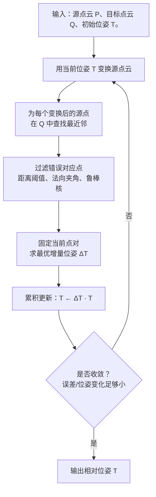
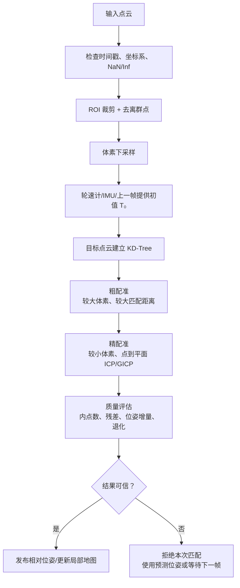

# ICP 点云匹配：从知识点到 SLAM 体系的学习指南

> **学习目标**：不把 ICP（Iterative Closest Point，迭代最近点）当作一个只能调用的 PCL API，而是沿着“问题 → 前置知识 → 数学推导 → 算法实现 → 工程可靠性 → SLAM 系统”的线索，理解它为什么成立、什么时候会失败，以及它在机器人定位建图中的位置。
>
> 公式约定：行内公式使用 `$...$`，独立公式使用 `$$...$$`。本文默认采用**列向量**，坐标变换方向为“源点云 → 目标点云”。

---

## 0. 先看全局：ICP 在知识体系中的位置

ICP 不是孤立的算法。它位于“传感器数据”与“机器人位姿估计”之间，依赖几何、线性代数和数值优化，也为激光里程计与 SLAM 提供相对运动约束。

```mermaid
flowchart TD
    A[激光雷达扫描
距离、角度、时间戳] --> B[点云表示
二维/三维坐标]
    B --> C[坐标变换
SE(2) / SE(3)]
    C --> D[点云预处理
裁剪、去噪、下采样]
    D --> E[对应关系搜索
KD-Tree 最近邻]
    E --> F[ICP 配准]
    F --> F1[点到点
最小二乘 + SVD]
    F --> F2[点到平面
法向量 + GN/LM]
    F1 --> G[相对位姿约束]
    F2 --> G
    G --> H[激光里程计]
    H --> I[局部地图匹配]
    I --> J[回环检测 + 位姿图优化]
    J --> K[SLAM 全局轨迹与地图]
```

可以将整条知识线概括为：

```text
点云是什么、点在何处
    ↓
两帧点云怎样处于同一坐标系
    ↓
哪些点可能是同一物理位置
    ↓
如何定义“两个点云对齐得好”
    ↓
如何求使误差最小的刚体位姿
    ↓
如何处理噪声、错配、退化和局部最优
    ↓
如何把许多帧相对位姿组织成 SLAM
```

---

# 第一部分：从真实问题出发

## 1. ICP 到底解决什么问题

机器人运动时，激光雷达连续采集到两帧点云：

- **源点云**（source）$P=\{p_i\}$：通常是当前帧；
- **目标点云**（target）$Q=\{q_j\}$：通常是上一帧、局部子地图或全局地图的一部分。

即使两帧都看到了同一面墙或同一个桌角，由于机器人位置和朝向不同，它们的坐标也不同。ICP 要估计一个刚体变换 $T$，使源点云变换后与目标点云尽量重合：

$$
q_i \approx Rp_i+t
$$

其中：

- $p_i\in\mathbb{R}^2$ 或 $\mathbb{R}^3$：源点；
- $q_i\in\mathbb{R}^2$ 或 $\mathbb{R}^3$：和 $p_i$ 对应的目标点；
- $R$：旋转矩阵；
- $t$：平移向量；
- $\approx$：受测量噪声、遮挡和匹配误差影响，只能近似相等。

### 1.1 一个直观例子

机器人面向一面墙向前移动了 $0.2\text{ m}$。当前帧和上一帧中，墙上点的相对位置发生了变化。若能估计“当前帧要旋转、平移多少才与上一帧重合”，就得到了机器人这段时间的相对运动。

```text
上一帧 / 目标点云 Q                 当前帧 / 源点云 P

墙：· · · · · · · · ·                墙：     · · · · · · · · ·
    │                                      │
    │                                      │
    └── 目标坐标系                          └── 当前坐标系

寻找 T，使 T·P 尽量覆盖到 Q 上。
```

### 1.2 ICP 的输入、输出与前提

| 项目 | 含义 |
| --- | --- |
| 输入 | 两帧点云，或当前点云与局部地图 |
| 可选输入 | 初始位姿估计，如轮速计、IMU、上一帧位姿 |
| 输出 | 源坐标系到目标坐标系的相对刚体变换 $T$ |
| 核心前提 | 两帧有足够重叠区域，初始位姿离正确解不能太远 |
| 典型用途 | 激光里程计、scan matching、建图、回环候选验证 |

> **关键理解**：ICP 不是“识别物体”的算法，也不会天然知道哪两个点是同一个物理点。它用距离和局部几何猜测对应关系，再不断修正这个猜测。

---

## 2. 为什么叫“迭代最近点”

ICP 的完整名称可拆成三个关键词：

| 单词 | 含义 | 对应算法动作 |
| --- | --- | --- |
| Iterative | 迭代 | 更新位姿后重新建立对应关系，直到收敛 |
| Closest | 最近 | 将每个源点匹配到目标点云中的最近邻 |
| Point | 点 | 最基本版本直接使用离散点；也可扩展为点到平面 |

完整流程如下：



ICP 可以理解为一种**交替优化**：

```text
当前位姿 T
    ↓
对应关系 C(T)      ← 对应关系依赖当前位姿
    ↓
固定 C 后求最优 T  ← 位姿又依赖当前对应关系
    ↓
重复
```

这正是它强大也脆弱的原因：

- 对应关系接近正确时，优化会越来越好；
- 初始位姿差太大时，最近邻会配错，算法会非常认真地优化到错误的位置。

---

# 第二部分：学习 ICP 前必须连起来的基础知识

## 3. 知识线 A：坐标系、刚体变换与 $SE(2)/SE(3)$

ICP 的结果不是“一个误差值”，而是机器人或传感器的位姿变化。因此首先要理解坐标系变换。

### 3.1 二维激光雷达：$SE(2)$

二维雷达点为：

$$
p=
\begin{bmatrix}
x\\
y
\end{bmatrix}
$$

位姿由平移 $(t_x,t_y)$ 和偏航角 $\theta$ 组成。旋转矩阵为：

$$
R(\theta)=
\begin{bmatrix}
\cos\theta & -\sin\theta\\
\sin\theta & \cos\theta
\end{bmatrix}
$$

坐标变换为：

$$
q=R(\theta)p+t
$$

二维刚体运动有 3 个自由度：$x$ 平移、$y$ 平移、绕 $z$ 轴旋转。这类变换组成李群 $SE(2)$。

### 3.2 三维点云：$SE(3)$

三维点为：

$$
p=
\begin{bmatrix}
x\\y\\z
\end{bmatrix}
$$

三维刚体运动有 6 个自由度：3 个平移、3 个旋转。使用齐次矩阵可统一写成：

$$
T=
\begin{bmatrix}
R & t\\
0 & 1
\end{bmatrix}
\in SE(3)
$$

对齐次坐标 $\tilde p=[x,y,z,1]^T$：

$$
\tilde q=T\tilde p
$$

```text
传感器坐标系 {L}                     世界/地图坐标系 {M}

       pᴸ ●                               ● qᴹ
            \                             /
             \       T_M←L               /
              └─────────────────────────┘

qᴹ = R_M←L · pᴸ + t_M←L
```

### 3.3 刚体变换为什么不允许缩放

ICP 默认求解的是**刚体变换**：形状、距离、角度都保持不变，只有旋转和平移。

合法旋转矩阵必须满足：

$$
R^TR=I,
\qquad
\det(R)=1
$$

- $R^TR=I$：列向量彼此正交且长度为 1，不产生拉伸；
- $\det(R)=1$：排除镜像反射。

这解释了为何不能简单对旋转矩阵的 9 个元素做普通最小二乘：普通线性求解不保证结果仍是合法旋转。

---

## 4. 知识线 B：误差、最小二乘与优化目标

“点云对齐得好”需要先转化为数学上可计算的误差。

### 4.1 残差与代价函数

当已知一对对应点 $p_i\leftrightarrow q_i$ 时，点到点残差为：

$$
r_i=Rp_i+t-q_i
$$

ICP 最经典的目标是最小化所有残差的平方和：

$$
\min_{R,t}\sum_{i=1}^{N}\lVert Rp_i+t-q_i\rVert^2
$$

为什么用平方？

- 正负误差不会相互抵消；
- 残差越大，惩罚增长越快；
- 可导、便于构造高效求解算法；
- 高斯噪声假设下，最小二乘也是最大似然估计。

但平方会过度放大离群点。这是后续“鲁棒核函数”和“外点剔除”必须出现的原因。

### 4.2 初值与局部最优

这类目标对旋转和对应关系并非全局凸。一个形象比喻是山谷：

```text
总代价
  ^
  |     全局最优 ●
  |             / \
  |    局部最优 ●   \___
  |           /             \
  +--------------------------------> 位姿参数
                   ↑
              初始位姿落在这里，
              ICP 可能停在局部最优
```

ICP 只能在初值附近逐步下降。因此外部里程计、IMU、匀速模型、上一帧估计并非可有可无，而是把 ICP 放进正确“收敛盆地”的关键。

---

## 5. 知识线 C：最近邻、KD-Tree 与对应关系

### 5.1 朴素最近邻为什么慢

假设当前已变换的源点为 $p'_i=Tp_i$。对它寻找最近目标点，需要计算：

$$
d_j^2=\lVert p'_i-q_j\rVert^2
$$

并选择距离最小的 $q_j$。

若源点、目标点数量分别为 $N,M$，暴力搜索一轮 ICP 的复杂度为：

$$
O(NM)
$$

大点云会使该步骤成为瓶颈。

### 5.2 KD-Tree 的空间剪枝思想

KD-Tree（K-Dimensional Tree）将目标点云按坐标轴递归切分。二维空间通常交替按 $x,y$ 切分，三维空间交替按 $x,y,z$ 切分；每次常使用中位数使树保持平衡。

```text
二维目标点云的空间划分

                      x = 5
                 ──────────────
                 /              \
              x < 5            x ≥ 5
               y = 3            y = 7
             ───────          ───────
             /     \          /     \
          左下    左上      右下    右上
```

搜索时先进入查询点所在的一侧；回溯时，只有当前最佳搜索圆/球可能跨过切分平面，才搜索另一侧。

若当前最佳距离为 $r$，查询点到切分平面的距离为 $d_{\text{plane}}$，则：

$$
d_{\text{plane}}>r
\quad\Rightarrow\quad
\text{另一侧不可能有更近点，可以剪枝}
$$

典型情况下，单次查询接近：

$$
O(\log M)
$$

因此一轮 ICP 对应搜索常接近：

$$
O(N\log M)
$$

> 在高维空间或点分布很差的情况下，KD-Tree 剪枝效果会减弱，最坏情况仍可能接近 $O(NM)$。但普通 2D/3D 激光点云正是它擅长的低维空间。

### 5.3 最近点不等于正确对应点

KD-Tree 只回答“谁距离最近”，不保证“谁是同一物理位置”。所以 ICP 需要增加几何约束。

| 规则 | 判断方法 | 防止的问题 |
| --- | --- | --- |
| 最大对应距离 | $\lVert p'_i-q_i\rVert<d_{\max}$ | 两帧不重叠时仍被硬匹配 |
| 互为最近邻 | $p$ 最近是 $q$，同时 $q$ 最近也是 $p$ | 单向密度差造成的错配 |
| 法向量夹角 | 两点法向量应大致平行 | 跨表面匹配 |
| Trimmed ICP | 仅保留残差最小的一部分点对 | 遮挡与局部重叠 |
| 鲁棒核 | 大残差点自动低权重 | 动态物体与离群噪声 |

这条知识线连接为：

```text
空间索引（KD-Tree）解决速度
    ↓
最近邻建立候选对应
    ↓
几何一致性与鲁棒统计解决可靠性
    ↓
保留下来的点对才可以进入位姿估计
```

---

## 6. 知识线 D：向量、外积、协方差、PCA 与 SVD

这条线是理解“为什么 ICP 能用 SVD 求旋转”和“为什么最小特征向量是平面法向量”的基础。

### 6.1 内积、外积与叉积

| 运算 | 写法 | 输出 | 在 ICP/点云中的作用 |
| --- | --- | --- | --- |
| 内积 | $a^Tb$ | 标量 | 夹角、投影、法向量相似性 |
| 外积 | $ab^T$ | 矩阵 | 协方差、互协方差 |
| 叉积（仅 3D） | $a\times b$ | 向量 | 旋转微分、法向量方向 |

对于二维向量 $p=[x,y]^T$，外积为：

$$
pp^T=
\begin{bmatrix}
x^2 & xy\\
xy & y^2
\end{bmatrix}
$$

对去中心化点不断累加外积，就能记录每个方向的分散程度以及不同坐标如何共同变化。

### 6.2 协方差矩阵：看“一组点自身长什么样”

对局部点集 $\{p_i\}$，先计算质心：

$$
\bar p=\frac{1}{N}\sum_{i=1}^{N}p_i
$$

再去中心化：

$$
\tilde p_i=p_i-\bar p
$$

总体协方差矩阵为：

$$
C=\frac{1}{N}\sum_{i=1}^{N}\tilde p_i\tilde p_i^T
$$


二维协方差矩阵展开为：

$$
C=
\begin{bmatrix}
\operatorname{Var}(x) & \operatorname{Cov}(x,y)\\
\operatorname{Cov}(x,y) & \operatorname{Var}(y)
\end{bmatrix}
$$

- 对角线：每个坐标轴的方差；
- 非对角线：两个坐标一起变化的程度；
- $C$ 是对称半正定矩阵，因此特征值都不小于 0。

### 6.3 PCA：找到点云“最展开”和“最扁”的方向

对协方差矩阵做特征值分解：

$$
Cv_j=\lambda_jv_j
$$

- $v_j$：第 $j$ 个主方向；
- $\lambda_j$：点云沿该方向的方差大小。

三维点云中，按：

$$
\lambda_1\ge\lambda_2\ge\lambda_3\ge0
$$

排序，局部几何可判断为：

| 特征值关系 | 局部形状 | 典型例子 |
| --- | --- | --- |
| $\lambda_1\gg\lambda_2\approx\lambda_3$ | 线状 | 杆、边缘、走廊延伸方向 |
| $\lambda_1\approx\lambda_2\gg\lambda_3$ | 平面状 | 墙、地面、桌面 |
| $\lambda_1\approx\lambda_2\approx\lambda_3$ | 团块状 | 角点、复杂结构附近 |

局部平面中，平面法向量方向上的点云厚度最小，因此：

$$
n=v_3
$$

```text
局部平面（侧视）

                    n = v₃，最小方差方向
                    ↑
                    │
  · · · · · · · · · │ · · · · · · · · ·
────────────────────┼──────────────────── 平面
         面内方向方差大：λ₁、λ₂
         垂直平面方差小：λ₃
```

这就将三件事连起来了：

```text
KD-Tree 找局部邻域
    ↓
协方差矩阵描述邻域形状
    ↓
PCA 找最小方差方向
    ↓
得到点到平面 ICP 需要的法向量
```

### 6.4 互协方差矩阵：看“两组对应点如何对齐”

协方差 $C$ 是“同一组点 × 自己”；ICP 的 SVD 需要的是“源点集 × 目标点集”的互协方差：

$$
H=\sum_{i=1}^{N}(p_i-\bar p)(q_i-\bar q)^T
$$

| 矩阵 | 看什么 | 典型用途 |
| --- | --- | --- |
| $C_p=\frac{1}{N}\sum\tilde p_i\tilde p_i^T$ | 源点集自身形状 | PCA、法向量、GICP |
| $C_q=\frac{1}{N}\sum\tilde q_i\tilde q_i^T$ | 目标点集自身形状 | PCA、法向量、GICP |
| $H=\sum\tilde p_i\tilde q_i^T$ | 两组对应点如何共同变化 | 点到点 ICP 的 SVD 求旋转 |

记忆方式：

```text
同一组点 × 自己      → 协方差 C：这组点“长什么样”
源点集 × 目标点集    → 互协方差 H：两组点“怎样旋转才能对齐”
```

---

# 第三部分：ICP 核心算法的两条主线

## 7. 主线 1：点到点 ICP —— 固定点对后用 SVD 求解

这是学习 ICP 最应先掌握的版本，因为目标函数直接、每轮有闭式解。

### 7.1 固定对应点后的问题

假设 KD-Tree 与过滤规则已经给出正确对应：

$$
p_i\leftrightarrow q_i
$$

要最小化：

$$
\min_{R,t}\sum_{i=1}^{N}\lVert Rp_i+t-q_i\rVert^2
$$

难点只在于旋转 $R$ 必须保持正交。解决路径是：先消去平移，再用 SVD 解决旋转。

### 7.2 第一步：计算两个质心

$$
\bar p=\frac{1}{N}\sum_{i=1}^{N}p_i,
\qquad
\bar q=\frac{1}{N}\sum_{i=1}^{N}q_i
$$

### 7.3 第二步：去中心化

$$
p_i'=p_i-\bar p,
\qquad
q_i'=q_i-\bar q
$$

去中心化后，两个点云中心都落在原点，平移影响被暂时移除。要解决的问题变成“两个形状如何旋转对齐”。

### 7.4 第三步：构造互协方差矩阵

$$
H=\sum_{i=1}^{N}p_i'{q_i'}^T
$$

`H` 记录源点和目标点在各方向上的关联。它是从“对应点数据”通往“最佳旋转”的桥梁。

### 7.5 第四步：对 $H$ 做 SVD

$$
H=U\Sigma V^T
$$

其中：

- $U,V$：正交矩阵；
- $\Sigma$：对角线为非负奇异值 $\sigma_1,\sigma_2,\sigma_3$ 的对角矩阵；
- 奇异值反映两个对应点集在各主方向上的有效信息量。

最优旋转为：

$$
R=VDU^T
$$

其中：

$$
D=\operatorname{diag}(1,1,\det(VU^T))
$$

最后恢复平移：

$$
t=\bar q-R\bar p
$$

完整知识链为：

```text
点对已知
    ↓
各自减质心：分离平移和旋转
    ↓
构造互协方差 H：描述两组点的方向关联
    ↓
SVD：提取两组点最匹配的正交方向
    ↓
R = VDUᵀ：得到合法旋转
    ↓
t = q̄ - R p̄：恢复平移
```

### 7.6 为什么需要 $D$：避免镜像反射

矩阵 $VU^T$ 虽然正交，却可能满足：

$$
\det(VU^T)=-1
$$

这代表其中混入了镜像反射，而真实机器人运动不可能把空间镜像翻转。因此用 $D$ 将最终旋转限制为：

$$
\det(R)=1
$$

### 7.7 SVD 的直观理解

SVD 将一个矩阵分解为：

$$
H=U\Sigma V^T
$$

可以把它想象成：

```text
输入方向
  ↓ Vᵀ：转到互协方差的主方向坐标系
  ↓ Σ ：沿这些方向衡量关联强弱
  ↓ U ：转到输出方向坐标系
```

在 ICP 中，$R=VDU^T$ 的本质是：**把源点集最主要的几何方向旋转到目标点集相匹配的方向**。

> SVD 只解决“固定点对下的最佳刚体变换”。完整 ICP 仍必须重建点对并迭代，因为正确对应关系在开始时未知。

---

## 8. 主线 2：点到平面 ICP —— 用法向量描述更合理的误差

点到点误差默认认为：目标点 $q_i$ 是源点 $p_i$ 的唯一理想落点。但连续墙面上，同一个源点沿墙面滑动少许通常没有本质区别；真正重要的是它是否偏离墙面。

### 8.1 点到平面误差

令 $q_i$ 是目标点，$n_i$ 是目标局部表面的单位法向量，则残差为：

$$
r_i=n_i^T(Rp_i+t-q_i)
$$

目标函数：

$$
\min_{R,t}\sum_{i=1}^{N}\left[n_i^T(Rp_i+t-q_i)\right]^2
$$

```text
点到点：                                点到平面：

p' ●───────● q                           p' ●
                                         / |
      计算完整点间距离                   /  |  只计算沿法向量 n 的距离
                                        /   ↓ n
──────────────────────── 目标表面      ──────────────── 目标平面
```

| 项目 | 点到点 ICP | 点到平面 ICP |
| --- | --- | --- |
| 优化对象 | 两点之间完整欧氏距离 | 点到目标局部切平面的距离 |
| 是否需要法向量 | 否 | 是 |
| 固定点对的求解 | SVD 闭式解 | 常用迭代线性化 |
| 靠近真值时的收敛速度 | 通常较慢 | 通常更快 |
| 更适合 | 稀疏点、入门、无可靠法向量 | 墙面、地面等稠密表面 |

### 8.2 为什么它连接到协方差、PCA 与 KD-Tree

点到平面 ICP 所需法向量不是凭空得到的：

```text
目标点 qᵢ
    ↓
KD-Tree 找 qᵢ 周围 k 个近邻
    ↓
计算近邻协方差 C
    ↓
特征值分解 / PCA
    ↓
最小特征值对应的特征向量 v₃
    ↓
法向量 nᵢ = v₃
    ↓
构造点到平面残差
```

这说明前面的 KD-Tree 和协方差并不是额外的零散知识，而是点到平面 ICP 的直接前置条件。

### 8.3 为什么需要李代数和 Gauss–Newton

点到平面问题中，旋转和平移耦合，通常没有像点到点 SVD 那样简单的闭式解。工程上在当前位姿附近，用一个很小的位姿增量 $\delta\xi\in\mathbb{R}^6$ 表示更新：

$$
\delta\xi=
\begin{bmatrix}
\delta\omega\\
\delta v
\end{bmatrix}
$$

- $\delta\omega$：小旋转；
- $\delta v$：小平移。

通过指数映射生成合法刚体增量：

$$
\Delta T=\exp(\delta\xi^\wedge)
$$

并更新：

$$
T\leftarrow\Delta T T
$$

将每个非线性残差在当前估计附近一阶线性化：

$$
r_i(\delta\xi)\approx r_i+J_i\delta\xi
$$

把所有点对叠加为：

$$
\min_{\delta\xi}\lVert J\delta\xi+r\rVert^2
$$

Gauss–Newton 的正规方程为：

$$
(J^TJ)\delta\xi=-J^Tr
$$

求得增量后更新位姿，重新计算对应关系，再继续迭代。

> 这条延伸线是：**刚体变换属于 $SE(3)$ 流形 → 用李代数表达小增量 → 对非线性残差求 Jacobian → 用 Gauss–Newton 或 LM 做局部最小二乘优化**。

---

# 第四部分：把算法放回工程现场

## 9. 从点云输入到可信位姿输出的工程管线

一个可用的 ICP 系统不只是调用 `align()`。应当形成下面的处理链：



### 9.1 预处理不是可选项

| 步骤 | 作用 | 不做的风险 |
| --- | --- | --- |
| 移除 NaN/Inf | 避免 KD-Tree 和矩阵计算异常 | 崩溃、无效结果 |
| 感兴趣区域裁剪 | 去掉远距离、车体自身等无关点 | 计算慢、错配增加 |
| 离群点去除 | 减少孤立噪点 | 最小二乘被异常点拉偏 |
| 体素下采样 | 降低计算量、平衡点密度 | 帧率低，近距离区域权重过大 |
| 法向量估计 | 支持点到平面 ICP | 无法使用表面约束 |

### 9.2 粗到细（coarse-to-fine）

大初始误差与细点云组合时，最近邻很容易错误。一个常用方案是分层配准：

```text
粗层：大体素 + 大匹配距离 + 点到点 ICP
    ↓ 处理较大的初始平移/旋转偏差
中层：中等分辨率 + 收紧距离阈值
    ↓
细层：小体素 + 点到平面 ICP / GICP
    ↓ 精细位姿
输出可信度评估
```

这与计算机视觉中的图像金字塔思想相同：先看粗结构避免落错位置，再看细节提高精度。

### 9.3 质量评估：不要只看“算法有没有返回结果”

ICP 总会给出一个变换，但不代表它可信。至少应联合检查：

| 指标 | 含义 | 可疑信号 |
| --- | --- | --- |
| 内点数量 | 通过过滤的有效匹配数 | 过少时缺乏约束 |
| 内点比例 | 有效点对占候选点对的比例 | 过低时说明重叠差或错配多 |
| RMSE / fitness score | 残差平均大小 | 大说明未对齐；过小也可能是局部错误重叠 |
| 位姿增量 | 本轮估计的平移、旋转变化 | 与运动学预测严重不符 |
| 是否收敛 | 停止条件是否满足 | 到最大迭代次数仍未稳定 |
| Hessian/特征值 | 某些自由度是否可观测 | 小特征值意味着几何退化 |

---

## 10. ICP 最常见的失败模式

### 10.1 初始位姿太差：局部最优

```text
真实对应关系：      当前错误最近邻关系：

P 的墙  ───────► Q 的同一面墙       P 的墙 ───────► Q 的另一面相似墙
      应该匹配                               距离更近但物理上错误
```

**改善方式**：里程计/IMU 初值、多分辨率配准、全局描述子、RANSAC 粗配准、限制最大对应距离。

### 10.2 动态物体与遮挡：对应点错误

行人、车辆、门、人群会导致两帧点云中的局部结构并非同一静态世界。

**改善方式**：鲁棒核、Trimmed ICP、语义剔除动态类别、时间一致性检查、局部地图而不是仅上一帧匹配。

### 10.3 几何退化：环境本身无法提供足够信息

| 环境 | 无法可靠估计的自由度 | 原因 |
| --- | --- | --- |
| 单面无限长墙 | 沿墙方向平移 | 沿墙滑动后几何几乎不变 |
| 长直走廊 | 沿走廊方向平移 | 两侧平行结构重复 |
| 单一平面 | 平面内平移、绕法向旋转 | 局部表面缺少这些方向的约束 |
| 对称场景 | 某些位置或角度 | 多个位置看起来一样 |

在线性化优化中，退化常反映为近似 Hessian：

$$
H_{\text{normal}}=J^TJ
$$

存在很小的特征值。其几何含义是：沿对应特征向量改变位姿，误差几乎不变化，算法就无法判断该自由度的真实值。

**改善方式**：融合 IMU/轮速计、积累更多视角、使用特征丰富区域、拒绝低可观测性结果，而不是盲信 ICP。

### 10.4 重复纹理与对称结构：低误差也可能错

仓库货架、长走廊、规则柱子会出现多个“看起来都很匹配”的位置。最终残差很小并不能证明全局姿态正确。

因此 SLAM 还需要：运动连续性约束、回环候选验证、全局图优化和其他传感器融合。

---

## 11. ICP 与 LaserMotion 运动去畸变的关系

当前工程中的运动去畸变与 ICP 都使用坐标变换，但它们分别回答不同问题。

| 问题 | 运动去畸变（Undistortion） | ICP 配准（Registration） |
| --- | --- | --- |
| 要解决什么 | 同一帧扫描内部，不同激光束采样时刻不一致 | 两帧或点云与地图之间的相对位姿未知 |
| 主要输入 | 激光束时间、里程计/TF 位姿 | 源点云、目标点云、初始位姿 |
| 位姿从哪里来 | 通常依赖已有里程计、IMU 或 TF | 从点云几何关系中估计 |
| 输出 | 补偿到统一时间的无畸变点云 | 两帧之间的相对刚体变换 |
| 两者怎么配合 | 先去畸变可提高点云几何一致性 | ICP 可估计或修正激光里程计 |

推荐的顺序是：

```text
原始扫描（不同点处于不同采样时刻）
    ↓
用 IMU/里程计/TF 进行运动去畸变
    ↓
得到时间一致的点云
    ↓
用 ICP 与上一帧/局部地图配准
    ↓
得到更可靠的相对位姿
```

如果运动很快却不去畸变，同一面静态墙会在单帧内被拉弯或拖影，ICP 会把这种传感器运动造成的形变误认为环境结构，从而增大匹配误差甚至估计错误位姿。

---

# 第五部分：从 ICP 延伸到 SLAM

## 12. ICP 在激光 SLAM 中承担的角色

### 12.1 Scan-to-Scan：帧间里程计

当前帧匹配上一帧：

$$
T_{k-1\leftarrow k}
$$

然后累积得到轨迹。优点是简单、实时；缺点是每帧的小误差都会积累。

### 12.2 Scan-to-Map：匹配局部子地图

当前帧匹配附近多帧融合而成的局部地图：

$$
T_{\text{local map}\leftarrow k}
$$

局部地图包含更多几何结构，通常比只匹配上一帧稳定，也更不容易被单帧稀疏或动态物体影响。

### 12.3 为什么仍会漂移

若连续累积相对位姿：

$$
T_{0\leftarrow k}
=
T_{0\leftarrow 1}
T_{1\leftarrow 2}
\cdots
T_{k-1\leftarrow k}
$$

每个相对位姿都有微小误差，长距离后必然积累为明显漂移。因此完整 SLAM 还需要全局约束。


### 12.4 ICP 的同类与升级方法

| 方法 | 核心思路 | 与 ICP 的关系 |
| --- | --- | --- |
| Point-to-Point ICP | 最小化对应点欧氏距离 | 基础版本 |
| Point-to-Plane ICP | 最小化沿法向量的距离 | 利用局部表面几何，提高局部收敛速度 |
| GICP | 为点引入局部协方差，使用马氏距离 | 统一点到点和点到平面的思想 |
| NDT | 栅格中拟合高斯分布，不显式固定点对 | scan-to-map 常用替代/补充方法 |
| 特征法 | 匹配边缘、平面、描述子 | 大场景下减少计算、增强全局匹配 |

GICP 的误差可写作：

$$
d_i^2=(Rp_i+t-q_i)^T
\left(C_{q_i}+RC_{p_i}R^T\right)^{-1}
(Rp_i+t-q_i)
$$

这就是协方差再次出现的地方：它不只用于求法向量，也用来表达某个局部点在各个方向上的几何不确定性。

---

# 第六部分：可执行的学习路线

## 13. 建议按“点 → 线 → 体系”完成的学习顺序

### 阶段 1：先抓住单个关键点

1. 二维点坐标、极坐标转直角坐标；
2. 旋转矩阵、平移、齐次变换；
3. 欧氏距离、残差、最小二乘；
4. KD-Tree 最近邻；
5. 向量内积、外积、矩阵转置；
6. 均值、方差、协方差；
7. 特征值、特征向量、PCA；
8. SVD。

### 阶段 2：把知识点串成算法线

```text
极坐标激光数据
    ↓
直角坐标点云
    ↓
用当前位姿变换源点云
    ↓
KD-Tree 找最近邻
    ↓
剔除不可信匹配
    ↓
点到点：质心 → 互协方差 → SVD → R,t
    或
点到平面：PCA 法向量 → Jacobian → GN/LM
    ↓
更新位姿并重新找对应
    ↓
收敛后得到相对位姿
```

### 阶段 3：把算法线放入系统

```text
传感器标定、时间同步
    ↓
去畸变与点云预处理
    ↓
ICP / GICP / NDT 局部配准
    ↓
激光里程计与局部地图
    ↓
关键帧、回环检测
    ↓
位姿图优化
    ↓
全局一致 SLAM 地图
```

## 14. 推荐练习：每一步验证一个知识连接

| 练习 | 验证的知识点 | 成功标准 |
| --- | --- | --- |
| 将二维极坐标激光转为点云并在 RViz 显示 | 极坐标、坐标系 | 点云形状与环境一致 |
| 人工给二维点集施加已知 $R,t$ | 刚体变换 | 变换后位置符合预期 |
| 对人工对应点实现 SVD 配准 | 质心、互协方差、SVD | 恢复的 $R,t$ 接近人工真值 |
| 对局部平面点计算协方差与法向量 | PCA、特征值 | 法向量垂直于平面 |
| 用 KD-Tree 为源点找目标最近邻 | 空间索引 | 与暴力搜索结果一致但更快 |
| 对两帧静态点云运行 ICP | 完整点到点 ICP | 配准后重叠，误差下降 |
| 故意给错误初值或单墙场景 | 局部最优、退化 | 理解何时结果不可信 |
| 加入里程计初值、鲁棒过滤与多层下采样 | 工程可靠性 | 成功率和稳定性提升 |

---

## 15. 最终总结：用一张图记住 ICP

```text
                       ┌────────────────────────┐
                       │  ICP 的真实问题         │
                       │  两帧点云相差什么位姿？ │
                       └───────────┬────────────┘
                                   │
                  ┌────────────────┴────────────────┐
                  │                                 │
        ┌─────────▼──────────┐            ┌─────────▼──────────┐
        │ 对应关系从哪里来？ │            │ 位姿如何求出来？   │
        └─────────┬──────────┘            └─────────┬──────────┘
                  │                                 │
        ┌─────────▼──────────┐            ┌─────────▼──────────────┐
        │ KD-Tree 最近邻      │            │ 点到点：SVD             │
        │ + 距离/法向过滤     │            │ 点到平面：PCA + GN/LM   │
        └─────────┬──────────┘            └─────────┬──────────────┘
                  │                                 │
                  └──────────────┬──────────────────┘
                                 │
                       ┌─────────▼──────────┐
                       │ 迭代更新位姿与点对  │
                       └─────────┬──────────┘
                                 │
             ┌───────────────────┼────────────────────┐
             │                   │                    │
   ┌─────────▼────────┐ ┌────────▼────────┐ ┌────────▼─────────┐
   │ 初值是否足够好？ │ │ 几何是否退化？  │ │ 动态物体/错配？  │
   │ 里程计、IMU      │ │ 墙、走廊、对称  │ │ 鲁棒核、外点过滤 │
   └──────────────────┘ └─────────────────┘ └──────────────────┘
                                 │
                       ┌─────────▼──────────┐
                       │ 可信的相对位姿约束  │
                       └─────────┬──────────┘
                                 │
                       ┌─────────▼──────────┐
                       │ 激光里程计与 SLAM   │
                       │ 回环、图优化、地图 │
                       └────────────────────┘
```

**一句话概括**：ICP 通过“在当前位姿下猜对应点，再在固定对应点下求最优刚体变换”的交替迭代完成配准；KD-Tree 让对应搜索足够快，协方差/PCA 提供局部表面几何，SVD 或 Gauss–Newton 求位姿，而初值、鲁棒性、几何可观测性和图优化决定它能否在真实 SLAM 系统中可靠工作。
